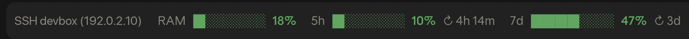

# ssh-usage-band

A [Claude Code](https://code.claude.com) mod that draws one row above the prompt: the machine
you're on, how much of its RAM is in use, and your 5-hour and 7-day usage limits with the time
until each resets.

```
SSH devbox (192.0.2.10)  RAM ██░░░░░░ 29%  5h █░░░░░░░ 18% ↻ 2h 41m  7d ███████░ 83% ↻ 6d  25m ago
```



It was made for working in Claude Code over SSH on a small Linux box, where it helps to see at
a glance which machine a session is on, whether it is running out of memory, and how close you
are to a usage limit.

## What it shows

| Part | Example | Where it comes from |
| --- | --- | --- |
| Host | `SSH devbox (192.0.2.10)` | `/etc/hostname`, and the server address (third field) of `SSH_CONNECTION`. Only the hostname when you're not on SSH. |
| RAM | `RAM ██░░░░░░ 29%` | `MemAvailable` and `MemTotal` in `/proc/meminfo`, read every 10 s. The bar fills with RAM in use. |
| 5-hour limit | `5h █░░░░░░░ 18% ↻ 2h 41m` | The session's usage readings. `↻` is the time until the window resets. |
| 7-day limit | `7d ███████░ 83% ↻ 6d` | The same. A day or more out it shows whole days only. |
| Spend limit | `spend ██░░░░░░ 25% …` | Shown instead of or beside the above when you're behind a Claude apps gateway with a spend limit. |
| Reading age | `25m ago` | Shown once the session's last usage reading is 5 minutes old or more. |

The row is sized to fit on one line in a normal-width window (about 100 columns with the
example above). In a narrower window, or with a long hostname, it wraps onto a second line.

### Colors

Every bar, RAM included, uses the same steps:

| Color | Usage bars (% used) | RAM bar (% free) |
| --- | --- | --- |
| green | under 70 % | 30 % or more |
| yellow | 70 % or more | under 30 % |
| orange | 80 % or more | under 20 % |
| red | 90 % or more | under 10 % |

The RAM bar is colored by what's free (strictly below each step), so it changes color where
the usage bars do.

### Why two sessions can show different usage figures

Claude Code only learns your usage figures from the API responses a session gets. Each session
keeps its own last reading. A session that has been idle for a while still shows the figures
from its last reply, even if another session has used more since then.

The band tells you when a reading may be out of date:

- **`25m ago`** (dim, at the end of the row): the session's last reading is that old. It shows
  from 5 minutes on. The next reply in that session refreshes it.
- **`5h ░░░░░░░░ reset`** (dim, no percentage): that window's reset time has passed since the
  reading was taken, so the old percentage no longer applies. The next reply brings the new
  window's figure.

The usage bars appear after the session's first reply. Until then the row shows only the host
and RAM.

### Why a mod and not a status line?

Claude Code's [status line](https://code.claude.com/docs/en/statusline) gets the same 5h and
7d figures, and a status line script could draw most of this row. But the Claude desktop app's
Code tab doesn't draw custom status lines; only the terminal does. This mod draws above the
prompt in both. It can also dim a window past its reset and show how old the reading is,
which a status line can't: Claude Code drops a window from the status line's data once it
resets, and that data carries no reading time.

## Requirements

- **Claude Code 2.1.293.** That's the version this was tested with (the tests also pass on
  2.1.286). The function-hooks plugin API it uses is early access and can change between
  releases.
- **A claude.ai Pro or Max subscription** for the 5h and 7d bars. Claude Code only reports
  usage limits to subscribers (or a spend limit behind a Claude apps gateway). With API-key
  billing there are no usage limits to show, and the row shows only the host and RAM. See
  `rate_limits` in the [status line docs](https://code.claude.com/docs/en/statusline).
- **Linux for the host and RAM parts.** They read `/etc/hostname` and `/proc/meminfo`. On macOS
  (and anywhere else those files don't exist) those parts are left out and only the usage bars
  show. Over SSH into a Mac the host part shows just `SSH <server ip>`, with no hostname.

## Install

### From the marketplace (recommended)

This repository is its own plugin marketplace. In a Claude Code session in a terminal, type:

```
/plugin install ssh-usage-band --marketplace RedRoosterKey/claude-code-ssh-usage-band
```

Answer `y` to add the marketplace, then pick a scope (user scope, the first one offered, loads
it in every session). The band shows up in that session straight away.

Or the same from your shell:

```bash
claude plugin marketplace add RedRoosterKey/claude-code-ssh-usage-band
```

```bash
claude plugin install ssh-usage-band@ssh-usage-band
```

`/plugin` isn't available in the Claude desktop app's Code tab. Install it from a terminal at
user scope and it loads in the desktop app's local sessions too.

### From a clone

Clone the repository, then point Claude Code at the folder. For one session:

```bash
claude --plugin-dir /path/to/claude-code-ssh-usage-band
```

For every session, including ones the desktop app starts, add it to the `env` block of
`~/.claude/settings.json` (it is not read from a project's settings). Use an absolute path
(`~` is allowed); separate several folders with `:`.

```json
{
  "env": {
    "CLAUDE_CODE_PLUGIN_DIRS": "~/src/claude-code-ssh-usage-band"
  }
}
```

## Update

Installed from the marketplace:

```bash
claude plugin marketplace update ssh-usage-band
```

```bash
claude plugin update ssh-usage-band@ssh-usage-band
```

Then run `/reload-plugins` in a session, or start a new one.

From a clone: `git pull`. See [Editing the mod](#editing-the-mod) for when the change shows up.

## Uninstall

Installed from the marketplace:

```bash
claude plugin uninstall ssh-usage-band@ssh-usage-band
```

```bash
claude plugin marketplace remove ssh-usage-band
```

From a clone: drop the `--plugin-dir` flag, or remove the folder from
`CLAUDE_CODE_PLUGIN_DIRS`, and start a new session.

## Development

```
.claude-plugin/plugin.json       manifest
.claude-plugin/marketplace.json  makes this repo a marketplace
hooks/hooks.json                 names the hooks module
hooks/register.tsx               the mod
types/index.d.ts                 the state contract
tests/band.test.ts               tests
```

### Running the tests

```bash
claude plugin test .
```

The tests run against Claude Code's own engine with a mocked clock, environment and filesystem.
They need no login and no network, which is also how CI runs them.

`claude plugin validate .` checks the manifest, the marketplace file and the hooks module the
way Claude Code will load them.

### Type-checking

Claude Code writes its type declarations into `.claude-plugin/types/` each time it loads the
mod from a plugin folder (`--plugin-dir` or `CLAUDE_CODE_PLUGIN_DIRS`). That folder is
generated, so it's in `.gitignore`. Once it exists:

```bash
npx -p typescript tsc -p .
```

### Editing the mod

When the mod is loaded from a plugin folder (`--plugin-dir` or `CLAUDE_CODE_PLUGIN_DIRS`):

- **An interactive terminal session** watches the folder. Saving a file reloads the mod in that
  session.
- **The desktop app's Code tab and other long-lived headless sessions (SDK)** load the mod once.
  Edits show up in a new session, unless `CLAUDE_CODE_PLUGIN_DIR_WATCH=1` is set in the
  environment or in the `env` block of `~/.claude/settings.json`.
- **`claude -p`** always loads it fresh.

A copy installed from the GitHub marketplace doesn't see edits to a clone at all. It changes
only through [Update](#update).

## License

[MIT](LICENSE)
